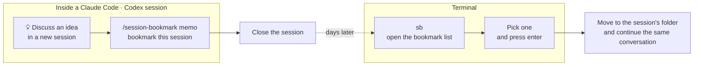

# session-bookmark (`sb`)

**English** | [한국어](README.ko.md)

A macOS command that bookmarks Claude Code and Codex sessions, so you can pick one from a list later and jump straight back into it.

You often open a new session to pour out an idea, then close the terminal. To get back to that session, you have to save its session ID somewhere and pass it to `--resume`. `sb` does that for you.

`sb` speaks English and Korean. See [Configuration](#configuration) to choose.

## Install

Requirements: macOS, zsh (the default macOS shell), [`jq`](https://jqlang.github.io/jq/), [`fzf`](https://github.com/junegunn/fzf)

```bash
brew install jq fzf     # only if missing
curl -fsSL https://raw.githubusercontent.com/david-learner/session-bookmark/main/install.sh | bash
```

You can also install from a clone.

```bash
git clone https://github.com/david-learner/session-bookmark.git
cd session-bookmark && ./install.sh
```

What the installer does:

1. Installs `sb` to `~/.local/bin`. Use `--prefix DIR` to install it elsewhere.
2. Installs the `session-bookmark` skill for Claude Code and Codex, if they are installed. Use `--no-skills` to skip this.
3. Creates an example config at `~/.config/session-bookmark/config`. An existing config is left untouched.
4. Backs up any file it would overwrite, if that file has changed, by appending a timestamp.

To uninstall, run `./install.sh --uninstall`. Your bookmarks and config are kept.

## Usage

### At a glance

You bookmark **inside a session** with the skill. You come back **from the terminal** with `sb`.



This is what `sb` looks like. The bookmark list is on top, and the details of the selected bookmark are below. Type to filter the list.


### Add a bookmark — with the skill, inside a session

Call the skill inside a session to bookmark that session. The agent names the bookmark after the conversation topic.

| Tool | Without a memo | With a memo |
|---|---|---|
| Claude Code | `/session-bookmark` | `/session-bookmark payment flow, continue tomorrow` |
| Codex | `$session-bookmark` | `$session-bookmark payment flow, continue tomorrow` |

The memo is saved exactly as you write it.

### List and enter — `sb` in the terminal

```
sb
```

The bookmark list is on top. The details of the selected bookmark (name, session ID, working folder, memo, resume command) are below.

Typing filters the list by name, memo and working folder. The whole memo is searched, even when it is cut off on screen.

| Key | Action |
|---|---|
| enter | Move to the session's folder and enter the session |
| ctrl-d | Delete the bookmark |
| esc | Close |

### Other commands

```
sb add             Pick a recent session from a list and bookmark it
sb add -p claude|codex [-n name] [-m memo] [-d folder] <session-id>
sb rm [session-id] Delete a bookmark (pick from the list if no ID is given)
sb go <session-id> Enter that bookmarked session directly
sb help
```

## If the session's folder was deleted

The session still opens when the folder you started it in is gone, for example after removing a worktree. The conversation history stays in `~/.claude` and `~/.codex`. `sb` asks:

```
Create an empty folder and open it there? (N opens it in the current folder) [y/N]
```

- **y** — Creates an empty folder at the original path and opens the session there. The conversation continues, but there is no code or git.
- **N** — Opens the session in the folder where you ran `sb`.

In a folder it has not opened before, Claude Code first asks "Yes, I trust this folder". For an empty folder created by `sb`, choose Yes.

## Configuration

Write the resume commands in `~/.config/session-bookmark/config`. If you leave them empty, `sb` uses `claude` and `codex` as is.

```bash
SB_CLAUDE_CMD="claude --permission-mode acceptEdits"
SB_CODEX_CMD="codex --search"
SB_LANG=en
```

- ⚠️ Do not write a shell alias name (such as `cc`). `sb` does not read your shell config, so aliases are not expanded. Write what the alias expands to.
- An environment variable with the same name takes precedence over the config file.

| Environment variable | Meaning | Default |
|---|---|---|
| `SB_CLAUDE_CMD` | Command to resume a Claude session | `claude` |
| `SB_CODEX_CMD` | Command to resume a Codex session | `codex` |
| `SB_LANG` | Screen language: `en` or `ko` | `ko` for a Korean locale, otherwise `en` |
| `SB_FILE` | Bookmark file | `~/.local/share/session-bookmark/bookmarks.jsonl` |
| `SB_CONFIG` | Config file | `~/.config/session-bookmark/config` |
| `SB_RECENT` | Number of recent sessions shown by `sb add` | `80` |
| `CLAUDE_CONFIG_DIR` | Claude Code data folder | `~/.claude` |
| `CODEX_HOME` | Codex data folder | `~/.codex` |

## Bookmark file

Bookmarks are stored in `~/.local/share/session-bookmark/bookmarks.jsonl`, one JSON object per line. `last_opened_at` is the last time you entered the session through `sb`. Resuming directly with `--resume`, without `sb`, is not recorded.

```json
{"provider":"claude","name":"Payment flow","session_id":"5f0c2a9e-7d41-4b8e-9c3a-2e6f1b8d4a70","cwd":"/Users/me/project","created_at":"2026-10-29 14:12","memo":"Continue tomorrow","last_opened_at":"2026-10-30 09:05"}
```

## Regenerating the demo GIF

Regenerate the GIF when the `sb` screen changes. The demo runs in a fake home folder (`/tmp/sb-demo`) and does not touch your real bookmarks.

```bash
brew install vhs
brew install --cask font-d2coding   # monospace font with Korean glyphs
vhs demo/demo.en.tape               # rebuilds docs/demo.en.gif
vhs demo/demo.ko.tape               # rebuilds docs/demo.ko.gif
```

## License

MIT
