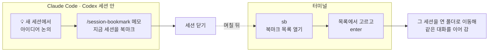

# session-bookmark (`sb`)

Claude Code·Codex 세션을 북마크해 두고, 나중에 목록에서 골라 그 세션으로 다시 들어가는 macOS 용 명령입니다.

떠오른 생각을 새 세션에서 쏟아 낸 뒤 터미널을 닫는 일이 많습니다. 그 세션으로 돌아가려면 세션 ID 를 따로 적어 두었다가 `--resume` 에 넘겨야 합니다. `sb` 는 이 일을 대신합니다.

## 설치

필요한 것: macOS, zsh(맥 기본 셸), [`jq`](https://jqlang.github.io/jq/), [`fzf`](https://github.com/junegunn/fzf)

```bash
brew install jq fzf     # 없을 때만
curl -fsSL https://raw.githubusercontent.com/david-learner/session-bookmark/main/install.sh | bash
```

저장소를 받아서 설치해도 됩니다.

```bash
git clone https://github.com/david-learner/session-bookmark.git
cd session-bookmark && ./install.sh
```

설치 스크립트가 하는 일:

1. `sb` 를 `~/.local/bin` 에 설치합니다. 다른 곳에 두려면 `--prefix DIR` 을 주세요.
2. Claude Code·Codex 가 있으면 `session-bookmark` 스킬을 설치합니다. 원하지 않으면 `--no-skills` 를 주세요.
3. 설정 파일 예시를 `~/.config/session-bookmark/config` 에 만듭니다. 이미 있으면 건드리지 않습니다.
4. 덮어쓸 파일이 바뀌어 있으면 날짜를 붙여 백업합니다.

지우려면 `./install.sh --uninstall` 을 실행하세요. 북마크와 설정은 남깁니다.

## 쓰는 법

### 한눈에 보기

북마크는 **세션 안에서** 스킬로 하고, 다시 들어가기는 **터미널에서** `sb` 로 합니다.



`sb` 화면은 이렇게 생겼습니다. 위는 북마크 목록, 아래는 고른 북마크의 상세입니다. 글자를 치면 목록이 걸러집니다.


### 북마크 추가 — 세션 안에서 스킬로

세션 안에서 스킬을 부르면 지금 세션이 북마크됩니다. 이름은 에이전트가 대화 주제로 짓습니다.

| 도구 | 메모 없이 | 메모와 함께 |
|---|---|---|
| Claude Code | `/session-bookmark` | `/session-bookmark 결제 흐름 논의, 내일 이어서` |
| Codex | `$session-bookmark` | `$session-bookmark 결제 흐름 논의, 내일 이어서` |

적은 메모는 고치지 않고 그대로 저장합니다.

### 북마크 목록과 진입 — 터미널에서 `sb`

```
sb
```

위에는 북마크 목록, 아래에는 고른 북마크의 상세(이름·세션 ID·작업 경로·메모·진입 명령)가 나옵니다.

| 키 | 하는 일 |
|---|---|
| enter | 그 세션을 연 폴더로 이동해 세션에 들어갑니다 |
| ctrl-d | 북마크를 지웁니다 |
| esc | 닫습니다 |

### 그 밖의 명령

```
sb add             최근 세션 목록에서 골라 북마크 추가
sb add -p claude|codex [-n 이름] [-m 메모] [-d 작업경로] <session-id>
sb rm [session-id] 북마크 제거 (인자 없으면 목록에서 고름)
sb go <session-id> 해당 북마크 세션으로 바로 진입
sb help
```

## 세션을 연 폴더가 지워졌다면

워크트리를 정리해 세션을 연 폴더가 없어도 세션은 열립니다. 대화 기록은 `~/.claude`·`~/.codex` 에 남아 있기 때문입니다. `sb` 는 이렇게 묻습니다.

```
빈 폴더를 만들고 열까요? (N 이면 현재 폴더에서 엽니다) [y/N]
```

- **y** — 원래 경로에 빈 폴더를 만들고 엽니다. 대화는 이어지지만 코드와 git 은 없습니다.
- **N** — `sb` 를 실행한 폴더에서 엽니다.

처음 여는 폴더에서는 Claude Code 가 「이 폴더를 신뢰합니까?」(Yes, I trust this folder)를 먼저 묻습니다. `sb` 가 만든 빈 폴더라면 Yes 를 고르면 됩니다.

## 설정

`~/.config/session-bookmark/config` 에 세션 진입 명령을 적습니다. 비워 두면 `claude`·`codex` 를 그대로 씁니다.

```bash
SB_CLAUDE_CMD="claude --dangerously-skip-permissions"
SB_CODEX_CMD="codex -s workspace-write -a on-request"
```

- ⚠️ 셸 별칭 이름(`cc` 등)을 적지 마세요. `sb` 는 셸 설정을 읽지 않아 별칭이 풀리지 않습니다. 별칭의 내용을 적으세요.
- 같은 이름의 환경 변수가 있으면 설정 파일보다 먼저 씁니다.

| 환경 변수 | 뜻 | 기본값 |
|---|---|---|
| `SB_CLAUDE_CMD` | Claude 세션 진입 명령 | `claude` |
| `SB_CODEX_CMD` | Codex 세션 진입 명령 | `codex` |
| `SB_FILE` | 북마크 파일 | `~/.local/share/session-bookmark/bookmarks.jsonl` |
| `SB_CONFIG` | 설정 파일 | `~/.config/session-bookmark/config` |
| `SB_RECENT` | `sb add` 목록에 보일 최근 세션 수 | `80` |
| `CLAUDE_CONFIG_DIR` | Claude Code 기록 위치 | `~/.claude` |
| `CODEX_HOME` | Codex 기록 위치 | `~/.codex` |

## 북마크 파일

`~/.local/share/session-bookmark/bookmarks.jsonl` 에 한 줄에 북마크 하나씩 JSON 으로 저장합니다.

```json
{"provider":"claude","name":"결제 흐름 논의","session_id":"0957a7cc-…","cwd":"/Users/me/project","created_at":"2026-10-29 14:12","memo":"내일 이어서"}
```

## 시연 GIF 다시 만들기

`sb` 화면이 바뀌면 GIF 도 다시 만드세요. 시연은 가짜 홈 폴더(`/tmp/sb-demo`)에서 돌아 실제 북마크를 쓰지 않습니다.

```bash
brew install vhs
brew install --cask font-d2coding   # 한글 고정폭 글꼴
vhs demo/demo.tape                  # docs/demo.gif 를 새로 만든다
```

## 라이선스

MIT
